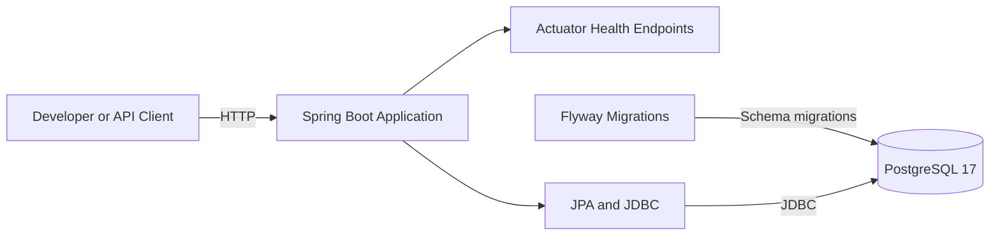
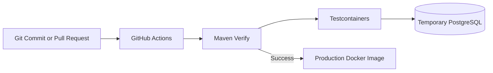

# Current Architecture

This document describes the current modular application and RAG storage foundation.

## Runtime architecture



The application can run directly from IntelliJ IDEA or as a Docker container.
PostgreSQL runs locally through Docker Compose.

## Build and test architecture



Integration tests do not depend on the developer's local PostgreSQL instance.
Testcontainers creates an isolated database, and Flyway applies the production
migrations before assertions are executed.

## Deployment unit

The application is currently one modular Spring Boot deployment unit:

```text
dev-assist-ai.jar
```

The production container contains:

- a Java 21 runtime;
- the executable application JAR;
- a non-root `app` user.

It does not contain Maven, source code, or build tools.

## Implemented components

- Spring Boot application;
- incident REST API and persistence;
- OpenAI and Ollama adapters behind the incident analysis endpoint;
- PostgreSQL persistence infrastructure with pgvector extension;
- isolated KnowledgeBase, document and chunk persistence, with a minimal KnowledgeBase REST API;
- optional explicit Incident–KnowledgeBase association and exact vector retrieval service;
- Flyway schema migrations;
- Actuator health endpoints;
- Docker Compose development database;
- Testcontainers integration testing;
- multi-stage production Docker image;
- GitHub Actions verification and image build.

## Planned components

The following components are not implemented yet:

- retrieval-augmented generation;
- operational tools;
- MCP;
- agentic workflow;
- production cloud deployment.

They will be added incrementally when their product use cases are implemented.

See [AI infrastructure](ai-integration.md) for configuration, component boundaries,
offline tests, and the remaining validation work.

See [RAG storage boundaries and pending pipeline](rag.md).
